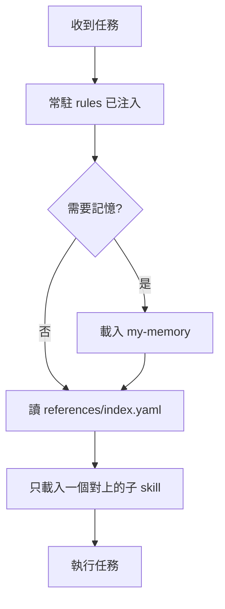

# 工作流入口

這份 skill **只負責分流**，不是規則全文。通用守則是常駐 rules（[`rules/my-rules.md`](../../rules/my-rules.md)），由 plugin 在對話開始時注入；維護、安裝、版本在 [`AGENTS.md`](../../AGENTS.md)。

## 何時載這份

- 新對話開始、不確定該用哪個 skill。
- 使用者提到工作習慣、入口、選 skill、改 my-workflow 套件。

## 載入順序

路徑相對於這份 `SKILL.md`；`rules/`、`references/` 在 plugin 根目錄。

1. **常駐 rules** — [`rules/my-rules.md`](../../rules/my-rules.md)，plugin 已注入；沒有注入的客戶端（見 README）先讀這份。
2. **[`../my-memory/SKILL.md`](../my-memory/SKILL.md)** — 僅在「記住、回想、偏好、決策、歷史脈絡」時，且優先於其他子 skill。
3. **[`references/index.yaml`](../../references/index.yaml)** — 用 `when` 或 `keywords` 對上**一筆**後，只載 `../<name>/SKILL.md`。
4. 查到 Mem0、或要升長期、或要遺忘時，改載 `../my-memory-consolidate/SKILL.md`。寫入不另搜；去重、加權與遺忘以那份的查詢時機為準。

同一對話已讀過的檔不必重讀。超過約 200 行的檔先讀摘要或索引，不要一次載整包。

## 怎麼選子 skill

| 做法 | 說明 |
|------|------|
| 對 keyword | 使用者原話與 `keywords` 最接近的一筆 |
| 對 when | 任務情境符合 `when` 描述 |
| 多筆都像 | 選範圍最小、最貼當前一步的那一個 |
| 對不上 | 先釐清需求；不要猜一個 skill 硬做 |

完整清單與版本號以 `index.yaml` 為準（與 `pack.yaml`、toolkit `project.json` 同號）。

## 不要做的事

- 不要一次載入 index 裡全部 skill。
- 不要在入口重寫 rules 或 `my-memory` 的細節。
- 不要改 `.cursor/skills/`（本 toolkit 由 [`scripts/export-cursor-skills.mjs`](../../scripts/export-cursor-skills.mjs) 匯出）；改 SSOT 在 `my-plugins/my-workflow/`。
- Cursor 斜線指令：`/my-workflow`（skill 名稱，不是子目錄名）。

## 改這個套件

先讀 [`AGENTS.md`](../../AGENTS.md)。新增子 skill 時：建立 `skills/<name>/SKILL.md`，並在 `index.yaml` 補 `when` 與 `keywords`。
