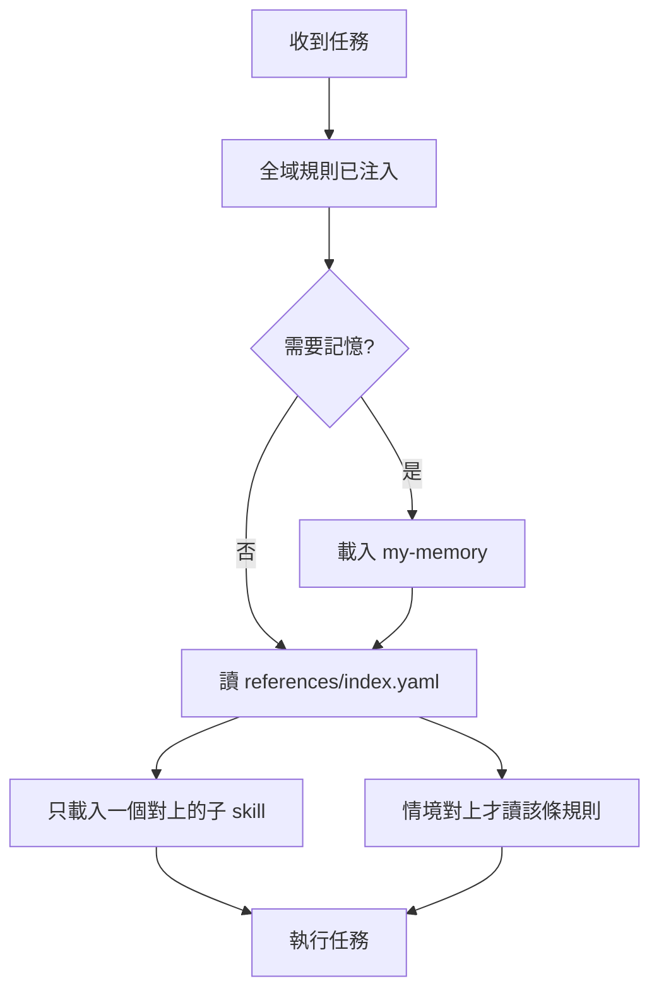

# 工作流入口

**只負責分流**，不是規則全文。全域規則 [`references/global.md`](references/global.md) 在 Claude Code、Codex 由 hook 注入；其他平台載入這份時自己讀。都**不需要本機腳本**。維護、安裝、版本見 [`AGENTS.md`](../../AGENTS.md)。

## 載入順序

路徑相對於這份 `SKILL.md`；`rules/` 在 plugin 根目錄。

1. **全域規則** — [`references/global.md`](references/global.md)。對話開頭沒看到「my-workflow plugin 已在對話開始載入」就先讀（網頁、Cowork、ChatGPT、Gemini 都是）。
2. **[`../my-memory/SKILL.md`](../my-memory/SKILL.md)** — 記住、回想、偏好、決策、歷史脈絡，或使用者問自己、公司、團隊的既有資訊而對話裡沒有答案時，優先於其他子 skill。
3. **[`references/index.yaml`](references/index.yaml)** — 用 `when` 或 `keywords` 對上**一筆**，只載 `../<name>/SKILL.md`。
4. **規則** — `index.yaml` 的 `rules` 區：碰到 `when` 的情境（commit、Code Review、收尾、寫腳本、安裝、用 MCP）才讀，可與一個 skill 並行。Git 工作習慣在 [`rules/git.md`](../../rules/git.md)；記憶規則在 `my-memory` 的 `rules/`，載入該 skill 時一併讀。
5. 記憶整理不在對話中做，由排程 agent 跑獨立 skill `my-memory-consolidate`。

同一對話已讀過的檔不重讀。超過約 200 行先讀摘要或索引。

## 怎麼選子 skill

| 做法 | 說明 |
|------|------|
| 對 keyword | 使用者原話與 `keywords` 最接近的一筆 |
| 對 when | 任務情境符合 `when` |
| 多筆都像 | 選範圍最小、最貼當前一步的 |
| 對不上 | 先釐清需求，不猜一個硬做 |

清單與版本以 `index.yaml` 為準（與 `pack.yaml`、toolkit `project.json` 同號）。

## 需要工具時

外部服務、App 或 MCP **先找 Composio**：`COMPOSIO_SEARCH_TOOLS` 搜 → `COMPOSIO_MANAGE_CONNECTIONS` 確認連線 → `COMPOSIO_MULTI_EXECUTE_TOOL` 執行；工具名以當下連上的為準。沒有、沒接上或失敗，先說結果再改用該服務自己的 MCP 或其他已接上的工具。本機檔案、Git、專案腳本不走 Composio。細節見 [`rules/tools.md`](../../rules/tools.md)。

## 不要做

- 不一次載入全部 skill 或全部 rules。
- 不在入口重寫 rules 或 `my-memory` 的細節。

## 改這個套件

先讀 [`AGENTS.md`](../../AGENTS.md)。新增子 skill：建 `skills/<name>/SKILL.md`，在 `index.yaml` 補 `when`、`keywords`；新增規則：建 `rules/<name>.md`，在 `index.yaml` 的 `rules` 區補。
