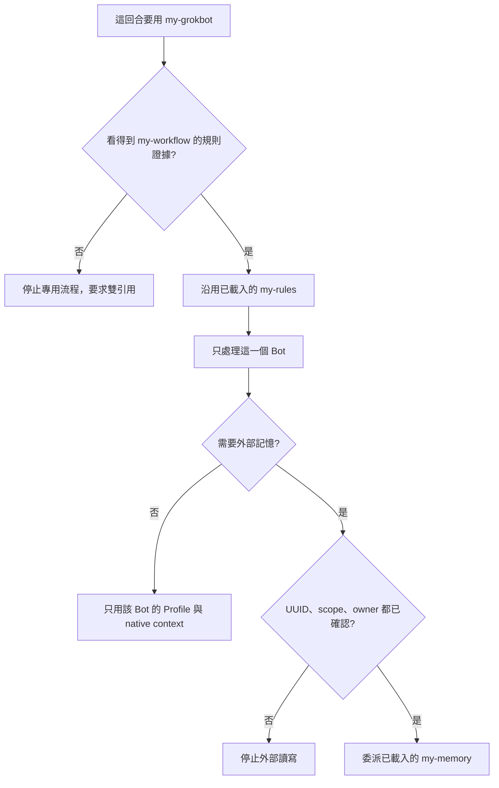

# my-grokbot

共用的是方法。每個 Bot 的人格、native memory、外部記憶與 Routine 各自隔離。

本 skill 不能查私人 skill 庫、不能呼叫另一個 skill，也不能把「兩個都已安裝」當成這回合已載入。Runtime 模式固定為 `explicit-pair`。

## 何時用

- 建立、修改或審查某一個 Grok Bot 的 Profile、記憶政策或 Routine。
- 為那一個 Bot 做睡眠整理。
- 稽核兩個 Bot 是否隔離。

平常聊天、與 Bot 設定無關的工作，不要套用本 skill。

## 必要輸入

缺了就停在該項，不猜測：

| 輸入 | 用途 |
|------|------|
| 目標 Bot identity | 平台可驗證的 UUID。顯示名稱只給人看 |
| 目的 | 建立、改 Profile、查記憶、做 Routine 或睡眠整理 |
| 目前 Profile | 沒有就用空白模板，不複製別的 Bot |
| memory policy | 只用 native，或已啟用的外部 scope 與 primary owner |

## 依賴閘門



看得到的證據，是這回合已經出現 `my-rules`（要寫外部記憶時還要有 `my-memory`）。沒有這份證據就停止，請使用者用新的一回合同時引用 `/my-workflow` 與 `/my-grokbot`。

安裝網址與停止文案見 [dependency.md](references/dependency.md)。不要把 `my-rules` 或 `my-memory` 抄進本 skill。

## 載入順序

1. 先過依賴閘門。
2. 沿用這回合已載入的 `my-rules`。
3. 讀 [bot-instance.md](references/bot-instance.md)。
4. 只再讀一份：人格讀 [soul.md](references/soul.md)，記憶讀 [memory.md](references/memory.md)，工具讀 [tools.md](references/tools.md)，睡眠讀 [sleep.md](references/sleep.md)，安裝與雙引用讀 [dependency.md](references/dependency.md)。
5. 需要系統邊界時讀 [system-model.md](references/system-model.md)。
6. 空白 Profile 用 [bot-profile.template.md](templates/bot-profile.template.md)。

## 衝突時

平台與組織安全規則最優先。目前使用者的明確指令優先於舊記憶，但高風險動作仍要這次核准。Profile 與任務方法衝突時，權限取較嚴的一邊。Bot A 與 Bot B 衝突時保持隔離。正確性優先於人格。Repo 現況優先於記憶。Routine 不能變成預先核准。

## 錯誤時

| 情況 | 做法 |
|------|------|
| 缺少 `/my-workflow` 證據 | 停止專用流程，給出安裝網址與雙引用範例 |
| UUID、scope 或 owner 不明 | 停止外部讀寫，不改用顯示名稱 |
| native 寫入無法讀回 | 標未驗證，不宣稱已儲存 |
| 外部後端失敗 | 寫出哪個後端、什麼失敗，不改口、不換後端充數 |
| 要改帳號端 Profile 或 Routine | 只出示 diff 或草稿，沒有另外授權就不執行 |

## 輸出

```text
Bot identity：<UUID；沒有就寫未確認，並停止外部記憶>
本回合依賴：explicit-pair 已確認，或缺少 my-workflow
做了什麼：
未驗證：
失敗：
待確認：
```

沒有做外部讀寫就不要寫成已記住。安裝與 Profile 套用步驟見 [README.md](README.md)。
