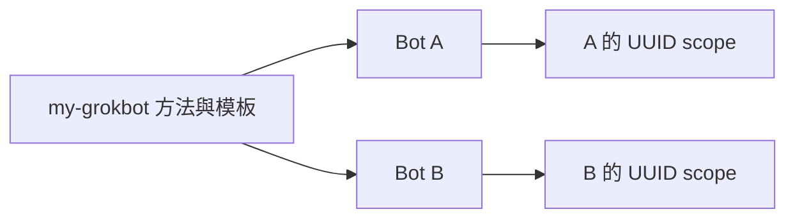

# 每個 Bot 各自一份

共用 `my-grokbot` 只提供規則與模板。Bot A 與 Bot B 的 Profile、native memory、外部 scope、Routine 互不覆蓋。

## 隔離鍵

外部記憶只用平台可驗證的 Bot UUID。顯示名稱、標籤、頭像與聊天標題都不能當隔離鍵。UUID 對不上就停止外部讀寫，不猜、不借用另一個 Bot。

## 每個 instance 要有的政策

| 項目 | 內容 |
|------|------|
| Identity | UUID、顯示名稱、職責、標籤。名稱可以改，UUID 不跟著名稱換 |
| Profile | 語氣、決策風格、工具邊界、要轉交的事 |
| Native memory | 哪些偏好由 host 管理、如何更正、有沒有讀回能力 |
| External memory | 是否啟用、scope、primary owner、哪些事實可以離開這個 Bot |
| Routine | owner、時區、輸入、輸出、沒資料時怎麼辦、核准點 |

預設外部記憶只進這個 UUID 的一般範圍。使用者當次明確指定共享或全域時才跨 Bot 讀寫。共享知識不能改寫個別人格，也不能當成外部動作的授權。

更新 A 的 Profile 之前，只顯示 A 的 diff。確認後也只改 A。不把 A 的人格、native 摘要或外部隔離鍵寫進共用 skill。

帳號端的建立、修改與刪除都要另一次明確授權。本檔不保存真實 Bot 資料。空白欄位見 [bot-profile.template.md](../templates/bot-profile.template.md)。
