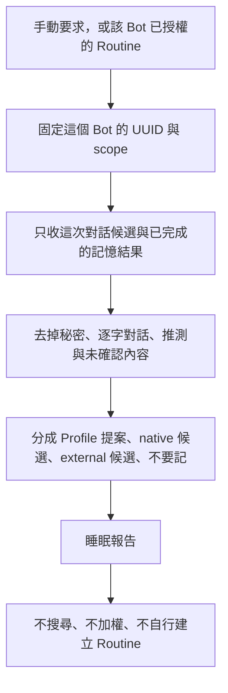

# 睡眠整理

「睡眠」只是整理候選的名稱。模型沒有睡眠，這也不是另一套記憶後端，更不是 OpenClaw Dreaming。

一次只整理觸發它的那一個 Bot。



## 禁止

- 不掃描完整 Mem0 或 Notion，不為找過期資料另開查詢。
- 不讀其他 Bot 的 Profile、native memory、對話或外部 scope。
- 不第二次整理，不再加權。這次回合若已整理過命中，只摘要那個結果。
- 不自動寫記憶。無人在場的 Routine 只產出候選與報告。
- 不修改 Profile、人格規則、工具規則、skill、Git、正式環境或外部服務。
- 不把一次性語氣、情緒或單次選擇升成人格或長期偏好。
- 沒有可用後端時寫「只產生候選，未儲存」。

## 報告

```text
Bot identity：<已驗證 UUID；無法確認就停止 external memory>
本次範圍：<該 Bot 的對話／時間範圍，不含整庫掃描或其他 Bot>
已完成：<只列有讀回證據的操作>
待確認記憶：<候選、建議 primary owner、scope、層級、原因>
規則／人格提案：<diff 摘要；未套用>
已遺忘：<只有這次整理真的刪除的 id 與摘要>
未處理／失敗：<後端、權限、資料缺口與下一步>
```

沒有 UUID 時，外部記憶相關欄位寫未確認並停止外部讀寫。其餘只報告這個 Bot 看得到的候選。
