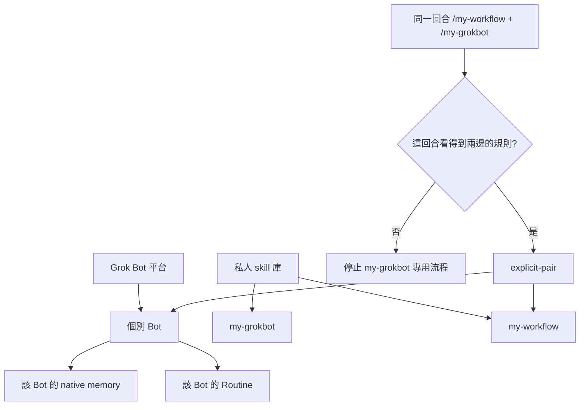

# 系統邊界

`my-grokbot` 與 `my-workflow` 是兩個獨立 skill。前者依賴後者。後者的索引不登記、也不反向依賴前者。

## 誰做什麼

| 層 | 做什麼 | 不做什麼 |
|----|--------|----------|
| 平台 | 權限、Auto Review、connector 範圍、帳號與作業系統限制 | 不因 skill 文字而放寬 |
| Bot Profile | 這個 Bot 的職責、語氣與核准邊界 | 不存放別的 Bot，也不當外部記憶隔離鍵 |
| `my-grokbot` | 建立、檢查、維護個別 Bot 的方法與空白模板 | 不保存人格或記憶內容，不授權工具 |
| `my-workflow` | `my-rules` 與外部記憶決策 | 不認識個別 Bot 人格 |
| Native memory | 該 Bot 由 host 管理的工作偏好 | 沒有讀回證據就不算已儲存 |
| 外部記憶 | 跨對話、可稽核、且已選 owner 的事實 | 不因新 chat 自動查詢 |
| Routine | 決定何時跑已驗證的流程 | 不擴大權限，不代替當次核准 |

## 硬限制與軟限制

硬限制由平台執行：Auto Review、connector scope、帳號權限、本機執行設定。軟限制寫在 Markdown：Profile、本 skill、記憶政策。軟限制不能推翻硬限制。文字裡的「先問」只是補充。

共用 skill 庫不等於共用人格。共用電腦與 connector 也不是 Bot 之間的安全隔離。秘密不放 Profile、skill、記憶或分享模板。

官方文件沒有可攜的 skill 依賴清單，也沒有證明一個 skill 能自行載入另一個。因此只接受同一回合的明確雙引用。此邊界若將來有實機證據，要另改契約，不能在單次任務裡改口。

OpenClaw 的 `SOUL.md`、`MEMORY.md`、`DREAMS.md` 只是設計類比。Grok Bot 不會原生讀取那些檔名。
