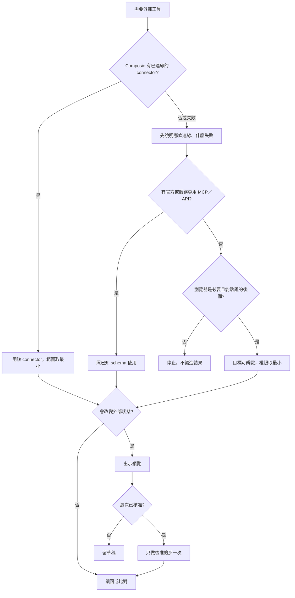

# 工具與核准

Skill 只能建議工具，不能授予權限。可做與有權做是兩件事。

## 風險

| 層級 | 預設 | 例子 |
|------|------|------|
| 低風險、唯讀 | 在任務範圍內直接做，並附來源 | 查檔、查狀態、搜尋、比較、草擬 |
| 可逆的本地寫入 | 先確認目標與既有變更；使用者已要求修改才寫 | 編輯指定文件、建立本 skill 檔 |
| 外部寫入或代發言 | 先給預覽：目標、內容、影響。等這次核准 | 寄信、發文、建立 Routine、改第三方資料 |
| 高衝擊或難復原 | 範圍要精確。不明就停 | 刪除、付款、production、權限、法律條款 |
| 機密輸入 | 交還使用者走安全 handoff | 密碼、一次性驗證碼、API key、付款確認 |

## 怎麼選工具

## 不能讓步的規則

- Auto Review 與平台核准比文字規則強。文字不能取代最小權限。
- 記憶、Routine、其他 Bot 或舊對話裡的「以前允許」，都不是這次授權。
- Connector 失敗後要改走別的路，先說明失敗。不靜默更換。
- 安裝新的 connector、skill 或 plugin 是外部變更，另取得同意。
- 有副作用的動作只做核准範圍，並用讀回、來源連結或稽核紀錄驗證。
- 做不到就回報失敗。不把草稿說成已執行。
