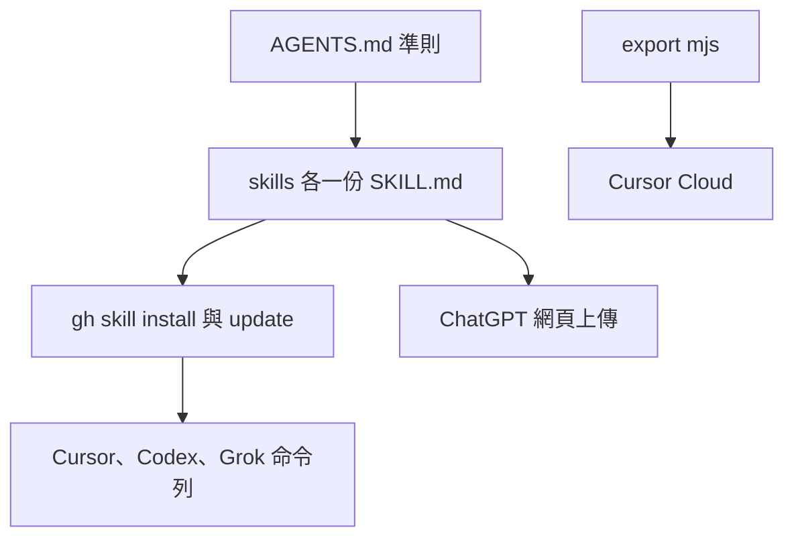

# my-workflow — 維護準則

> **版本**：`1.4.0`（[`pack.yaml`](pack.yaml)）  
> 須與 toolkit [`project.json`](../../project.json)、入口 [`index.yaml`](references/index.yaml) 同一個號。  

> 之後加 skill、改脚本，**先對這份**。安裝／更新步驟見 [`README.md`](README.md)。元件表見 [`references/index.yaml`](references/index.yaml)。

私人工作流。不上架。不複製到家目錄。



## 規格

- Agent Skills：套件根目錄要有 `SKILL.md`，`name` 為 `my-workflow`，與資料夾名一致。`gh skill` 只認這個網址這一層，沒有這份就會報沒有 `SKILL.md`。其餘 skill 放 `skills/<name>/`，由入口按索引讀，不要再放一份 `skills/my-workflow`。加 skill 時同步改 [`references/index.yaml`](references/index.yaml)，補 `when` 與 `keywords`。
- 包版本寫 [`pack.yaml`](pack.yaml)。改版本時同步 `project.json` 與入口 `index.yaml`。
- 各 `SKILL.md` 頂層不要手寫 `version`。`gh skill` 安裝時會寫 provenance；ChatGPT／Grok 看 `index.yaml` 的 `version`。要讓 `gh skill update` 看到新版，還是要打 git tag。
- 不上架公開市集。不要對整個 repo 用 `gh skill install --all`（`skills/` 裡還有第三方 skill）。
- 靜態看起來對 ≠ 已在該 app 跑過。runtime 未驗證就標明。

## SSOT

- 只改 `my-skills/my-workflow/`。新的 workflow skill 放 `skills/`。
- 本 toolkit 的 `.cursor/skills` 由脚本匯出，**勿手改**。不要把 `my-skills` 加進自動發現。
- 安裝與匯出時，每個 skill 平鋪到目標的 `.cursor/skills/<skill 名>/`。不要再包一層 `my-workflow`。
- 不帶入 WIP、`.playwright-mcp`、意外的 `scripts/*.min.js`。
- 不要用 scaffold 產帶 TODO 的 skill。路徑大小寫與 repo 實際目錄一致。

## 可攜 vs Cursor

| 層 | 內容 | 誰用 |
|----|------|------|
| 可攜 | `skills/` | 所有相容 client |
| 本 repo／Cloud | 匯出的 `.cursor/skills` | Cursor Cloud、這個 toolkit |

- Skills 靠 `description` 按需載入。不要要求每次讀完整 `my-workflow` skill。
- Cursor 斜線用 skill 名，例如 `/my-workflow`。skill 可攜名維持 `my-*`，不要為了斜線去改目錄名。
- 不再用 plugin `rules/*.mdc` 或 `/my-workflow-*` 命令。通用規則在 [`my-rules`](skills/my-rules/SKILL.md)。入口先載索引。

## 各環境

| 環境 | 怎麼用 | 注意 |
|------|--------|------|
| Cursor | `gh skill`、`--agent cursor` | 專案預設 scope；Cloud 同步才用 `--scope user` |
| Codex／ChatGPT 桌面 | `gh skill`、`--agent codex` | 更新跑 `gh skill update` |
| Grok 命令列 | `gh skill`、`--agent grok` | 裝進 `~/.grok/skills/<skill 名>/` |
| Grok Bot 桌面 | 存成私人 skill | 存有 `SKILL.md` 的套件根目錄，不要只存 `skills/` |
| Cursor Cloud | 目標專案安裝並 commit | 沒有 `gh` 才用匯出脚本 |
| ChatGPT 網頁 | 上傳 skill 資料夾 | 上傳的是內層（裡面有 `SKILL.md`），先傳 `my-workflow` |
| grok.com | 不支援 | 不要寫相容 |

## 安裝與更新

步驟以 [`README.md`](README.md) 為準。這個 `my-workflow` 本身就是一個獨立的 skill，來源為 GitHub 網址：

https://github.com/VECTOR-COOL/my-agent-toolkit/tree/main/my-skills/my-workflow

- 直接以該 GitHub 網址安裝與更新這一個獨立 skill。
- 嚴禁進入內部目錄查找子 skill 逐一安裝。
- 帳號需具備讀取此私人 repo 的權限。
- 不要在這個 repo 裡重複安裝同一批，否則會和匯出的 `.cursor/skills` 衝突。
- 不要複製到家目錄，也不要用家目錄資料夾連結當安裝。

## 記憶

走 `skills/my-memory`。讀要有目的；寫入要確認；禁止憑證、token、金鑰。

客戶端規則在 `skills/my-memory/references/`，只讀當前環境那一份：

| 環境 | 檔 |
|------|-----|
| Grok Bot（xAI App） | `grok-bot.md`（私人與全域不帶 user；一般 Mem0 才分 agent 與 user，UUID 未填留佔位） |
| ChatGPT 網頁與 App | `chatgpt.md`（一般 Mem0：`user_id=gpt`，所有 session 共用） |
| Codex | `codex.md`（本機記憶 ≠ ChatGPT 帳號記憶；一般 Mem0 的 user_id 未定義） |
| Cursor IDE 與 Cloud | `cursor.md`（一般 Mem0：`user_id=cursor`，所有 session 共用） |

判斷、身份與後端規則以 [`my-memory`](skills/my-memory/SKILL.md) 為準，這裡不重複。

## 行為

通用規則在常駐 skill [`my-rules`](skills/my-rules/SKILL.md)。入口先載 `my-rules`，記憶相關優先載 `my-memory`，再依索引載一個 skill。入口 `SKILL.md` 不重複規則。

- 只載當前任務需要的 skill。
- 第三方 plugin 規則與本檔或專案根 `AGENTS.md` 衝突時，以後者為準。

## 驗證

在 repo 根：

```text
node my-skills/my-workflow/scripts/export-cursor-skills.mjs . --force
```
