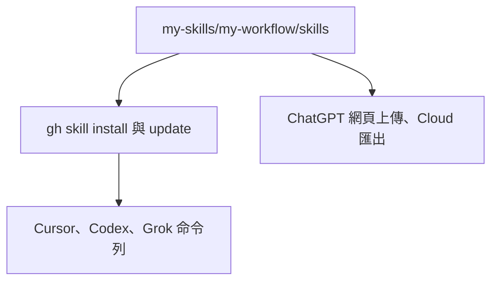

# my-workflow

私人工作流，採 [Agent Skills](https://agentskills.io) 規範。不上架公開市集。版本見 [`pack.yaml`](pack.yaml)，目前 `1.3.0`。

入口是 [`skills/my-workflow/SKILL.md`](skills/my-workflow/SKILL.md)。瀏覽說明見 [`skills/README.md`](skills/README.md)。選哪個 skill 見 [`skills/my-workflow/references/index.yaml`](skills/my-workflow/references/index.yaml)。集合根不要放 `SKILL.md`。

https://github.com/VECTOR-COOL/my-agent-toolkit/tree/develop/my-skills/my-workflow



安裝與更新走 [gh skill](https://cli.github.com/manual/gh_skill_install)。需要 GitHub CLI 2.90.0 以上，帳號要能讀這個私人 repo。各 app 用自己的 `--agent`。不要複製到家目錄，也不要做家目錄資料夾連結。

## 維護

之後加 skill、改脚本，先對 [`AGENTS.md`](AGENTS.md)。安裝／更新步驟見本檔。

- SSOT 是 `my-skills/my-workflow/skills/<skill 名>/`。每個資料夾一份 `SKILL.md`。`name` 必須與資料夾名一致。
- 本 toolkit 的 `.cursor/skills` 由脚本匯出，**勿手改**。不要把 `my-skills` 加進自動發現。
- 包版本寫 `pack.yaml`。各 `SKILL.md` 頂層不要手寫 `version`。要讓 `gh skill update` 看到新版，還是要打 git tag。
- 安裝與匯出時，每個 skill 平鋪到目標的 `.cursor/skills/<skill 名>/`。不要再包一層 `my-workflow`。
- 不帶入 WIP、`.playwright-mcp`、意外的 `scripts/*.min.js`。
- 新的 workflow skill 放這裡。

## 安裝與更新 prompt

貼給任何 app，它會自己判斷環境：

```text
安裝或更新我的私人 skills my-workflow，來源 https://github.com/VECTOR-COOL/my-agent-toolkit/tree/develop/my-skills/my-workflow/skills

能執行指令：用 gh skill（需 GitHub CLI 2.90.0 以上），--agent 填你自己（cursor、codex、grok）。
gh skill install VECTOR-COOL/my-agent-toolkit my-skills/my-workflow/skills/my-workflow --agent <你>
已裝就 gh skill update。其餘 skill 用到再裝。不要用 --all。Cursor Cloud 在目標專案安裝並 commit。
不能執行指令：把上述目錄下的單一資料夾（含 SKILL.md）存成私人 skill，先存 my-workflow，更新就覆寫。
不支援（如 grok.com）：說明不能裝。

不要複製到家目錄、不要改這個 repo。做不到就停，說明卡在哪。
```

## 安裝與更新

用上面的通用 prompt，不分環境。要點：

- repo 要先推上 GitHub，帳號要能讀這個私有 repo。
- 能執行指令：`gh skill install`／`gh skill update`，`--agent` 填該 app 自己。不能執行指令：存成或上傳單一 skill 資料夾，更新就覆寫。
- 只裝這包：對 `my-skills/my-workflow/skills/` 底下每個含 `SKILL.md` 的資料夾各跑一次，先裝入口 `my-workflow`。不要用 `--all`，這個 repo 的 `skills/` 還有第三方 skill。
- `gh skill` 沒有 `--ref`。未釘版時用最新 tag，沒有 tag 才用預設分支；要讓更新被看到，就打新 tag。釘版：路徑後加 `@v1.3.0` 或 `--pin v1.3.0`，釘住的不會被 update。
- `gh skill update` 比對安裝時寫進 `SKILL.md` 的 tree SHA，不是手改版本號。
- 不要在這個 repo 裡用 `gh skill install` 再裝同一批，否則會和匯出的 `.cursor/skills` 變成兩份。

## 沒有 gh 時的匯出

沒有 `gh` 時才用：

```text
node my-skills/my-workflow/scripts/export-cursor-skills.mjs <目標專案> --dry-run
node my-skills/my-workflow/scripts/export-cursor-skills.mjs <目標專案> --force
```

會平鋪寫入 `<目標專案>/.cursor/skills/<skill 名>/`，不複製規則。那些檔由這個脚本產生，不要手改。改完後在該專案 commit。

本 toolkit 已匯出一份，給這個 repo 的 Cloud Agent 用。

## 元件

| 類別 | 何時使用 | Skill 名稱 |
|------|----------|------------|
| 路由入口 | 新對話、未知需求分流、全域導航 | `my-workflow` |
| 常駐規則 | 開發規範、工程準則、溝通與記憶規則 | `my-rules` |
| 記憶管理 | 偏好決策記憶、跨階段狀態存取 | `my-memory` |
| 知識庫管理 | Notion API、頁面與資料庫自動化同步 | `my-notion` |
| 技術文件 | 規格書、技術手冊、架構決策 ADR 撰寫 | `my-docs` |
| 需求規劃 | 產品需求訪談、PRD 規格收斂撰寫 | `my-create-prd` |
| 介面體驗 | 設計系統、UI/UX 互動美化與風格指南 | `my-ui-ux` |
| 品質審查 | 計畫防飄移審查、Code Review、安全與驗收 | `my-review` |
| 程式庫維護 | 代碼庫瘦身、孤立檔案與死碼安全清理 | `my-codebase-clear` |
| 專案初始化 | 模板骨架生成、新專案與遠端 Repo 初始配置 | `my-codebase-init` |
| 安全提交 | 機敏過濾、繁中語意化 Conventional Commits 提交與推送 | `my-commit-all-and-push` |
| 雲端代理 | Cursor Cloud Agent 環境、對話建立與排程 | `my-cursor-cloud-agent` |
| 多線協同 | 複雜任務拆解、子代理平行派發與獨立驗收 | `my-subagent` |
| 版本升級 | 依賴套件安全升級計畫、斷裂變更與相容性評估 | `my-upgrade-plan` |
| 套件維護 | 檢查與更新 `gh skill` 安裝的工作流套件 | `my-skill-update` |

完整關鍵字與觸發對照見 [元件目錄](skills/my-workflow/references/index.yaml)。Cursor 斜線指令直接用 Skill 名稱。

## 記憶

走 `skills/my-memory`。讀要有目的；寫入要確認；禁止憑證、token、金鑰。

客戶端規則在 `skills/my-memory/references/`，只讀當前環境那一份：

| 環境 | 檔 |
|------|-----|
| Grok Bot（xAI App） | `grok-bot.md` |
| ChatGPT 網頁與 App | `chatgpt.md` |
| Codex | `codex.md` |
| Cursor IDE 與 Cloud | `cursor.md` |

## 行為

- 繁體中文、精簡、說人話。文件流程圖用 `graph TD`／`graph LR`／`graph TB`，不用 `flowchart`。
- 只載當前任務需要的 skill。
- 專案腳本用 `.mjs`。PowerShell 容易卡住，不要為本專案新寫 PowerShell 或 Python。這只限專案程式；既有第三方不改，也不改第三方套件。改檔腳本要 `--help`、非零失敗碼。
- Git：禁止 force push 到 `main`、`develop`、`release/*`。不提交 secrets。本地要使用者要求才 commit。不確定是不是雲端就當本地。禁止掃系統來猜。
- Cursor Cloud Agent、建立雲端工作環境、開／續／查／停雲端對話：載 `my-cursor-cloud-agent`。
- 第三方 plugin 規則與本檔或專案根 `AGENTS.md` 衝突時，以後者為準。
- 介面工作才載 `my-ui-ux`。有 `DESIGN.md` 就當設計來源。
- `GLOBAL_AGENTS.md` 只依序找：`AI_ASSISTANTS_HOME`／`GLOBAL_AGENTS_PATH` → 工作區 `ai_assistants.yaml` 若有路徑 → 工作區內檔名剛好是 `GLOBAL_AGENTS.md`。禁止掃磁碟、禁止把 `D:\...` 當必要路徑。找不到就只用本套件。
- 路徑大小寫與 repo 實際目錄一致。
