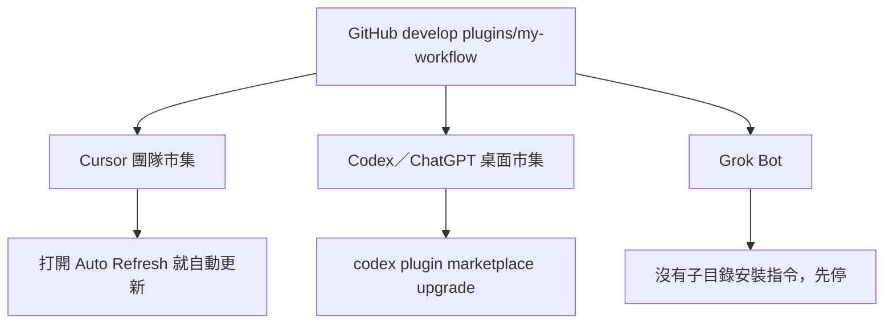

# my-workflow

私人工作流。不上架公開市集。plugin 版本 `0.2.1`。

之後開發維護以 [`AGENTS.md`](AGENTS.md) 為準。元件表見 [`skills/my-workflow/references/index.md`](skills/my-workflow/references/index.md)。

安裝與更新都用 plugin 目錄，不是整個 repo。追蹤分支 `develop`。

https://github.com/VECTOR-COOL/my-agent-toolkit/tree/develop/plugins/my-workflow

不要複製到家目錄，也不要再用家目錄資料夾連結。



斜線命令一律 `my-workflow-` 開頭，例如 `/my-workflow-update`、`/my-workflow-docs`。入口 skill 仍是 `my-workflow`。

## 安裝 prompt

貼給 agent：

```text
安裝我的私人 plugin my-workflow。用 GitHub，不要複製，不要做家目錄資料夾連結。

Plugin 目錄：https://github.com/VECTOR-COOL/my-agent-toolkit/tree/develop/plugins/my-workflow
不要把 https://github.com/VECTOR-COOL/my-agent-toolkit 當成 plugin。

Cursor（要會自動更新的那種）：
1. 不要用 /add-plugin。那個會停在舊 commit。
2. 打開 Dashboard → Plugins & MCPs → Team Marketplaces → Add Marketplace → Import from Repo。
3. 貼上面的 plugin 目錄網址，追蹤 develop。若畫面只收 repo 網址，來源仍要限在 plugins/my-workflow，不要裝整個 toolkit。
4. Marketplace Settings 打開 Auto Refresh 並存檔。需要這個 repo 已裝 Cursor GitHub App。
5. 到 Customize 安裝 my-workflow。
6. 若這台沒有 Teams／Enterprise，或你開不了 Dashboard，停下來告訴我卡在哪，不要改裝別的方法。

Codex 或 ChatGPT 桌面：
先跑 codex plugin marketplace --help。沒有這條指令就停下來，請我升級 Codex。不要改走複製或家目錄連結。
有的話執行：
codex plugin marketplace add https://github.com/VECTOR-COOL/my-agent-toolkit.git --ref develop --sparse .agents/plugins --sparse plugins/my-workflow
市集根是倉庫根，不是 plugins/my-workflow。清單在倉庫根 .agents/plugins/marketplace.json，只列這一個 plugin。兩段都要；只取子目錄會報 marketplace root does not contain a supported manifest。
然後在 /plugins 安裝 my-workflow。

Grok Bot：
不要跑 grok plugin install。那是 Grok Build 的命令列，不是 Grok Bot。
Grok Bot 沒有從 GitHub 子目錄安裝 plugin 的指令。停下來說明，不要改走別的方法，也不要叫人先裝 Grok Build。

不要處理 Cursor Cloud、ChatGPT 網頁、grok.com。
不要 commit，不要改 plugin 內容。
完成後用一行說明每個環境裝到哪、Cursor 的自動更新開了沒有。
```

## 更新 prompt

貼給 agent：

```text
更新我的私人 plugin my-workflow。只更新這個目錄，不是整個 repo：
https://github.com/VECTOR-COOL/my-agent-toolkit/tree/develop/plugins/my-workflow

依環境做，不要混用：

1. Cursor 若已用團隊市集且 Auto Refresh 開著：不要 pull、不要重裝。告訴我推上 develop 後重開視窗就會更新。
2. Codex 或 ChatGPT 桌面：執行 codex plugin marketplace upgrade。沒有這條市集就先說，不要改走別的安裝。
3. Grok Bot：不要跑 grok plugin update。那是 Grok Build。Grok Bot 沒有這條更新，停下來說明。
4. Cursor Cloud：在 plugin 目錄執行
   node scripts/export-cursor-skills.mjs <目標專案> --force
   然後只在該目標專案 commit。目標專案沒指定就停下來問。
5. ChatGPT 網頁、grok.com：直接說不能用這條 GitHub 更新。

不要複製 plugin，不要覆蓋別的安裝，不要強制合併，不要改 Git 設定。
```

## 安裝

repo 要先推上 `develop`，而且帳號要能讀這個私有 repo。下面兩種裝法都還沒在這台機器跑過。

### Cursor

要用會自動更新的裝法。需要 Teams 或 Enterprise，以及這個 repo 上的 Cursor GitHub App。

1. Dashboard → Plugins & MCPs → Team Marketplaces → Add Marketplace → Import from Repo。
2. 貼 `https://github.com/VECTOR-COOL/my-agent-toolkit/tree/develop/plugins/my-workflow`。這是 plugin 目錄，不是整個 repo。
3. Marketplace Settings 打開 **Auto Refresh**，存檔。
4. Customize 安裝 `my-workflow`。

推上 `develop` 之後，Cursor 最多約 10 分鐘重新索引一次。重開視窗或視窗回到前景就會換成新版。不要用個人的 `/add-plugin` 貼 GitHub，那個會停在當初的 commit，不會跟著更新。

### Codex 與 ChatGPT 桌面

先確認有 `codex plugin marketplace`。沒有就先升級 Codex。

```text
codex plugin marketplace add https://github.com/VECTOR-COOL/my-agent-toolkit.git --ref develop --sparse .agents/plugins --sparse plugins/my-workflow
```

市集根是倉庫根。清單在倉庫根 [`.agents/plugins/marketplace.json`](../../.agents/plugins/marketplace.json)，只列 `my-workflow`。`--sparse` 只少抓檔，不會把 `plugins/my-workflow` 變成市集根，所以兩段都要。然後在 `/plugins` 或桌面的 Plugins 安裝 `my-workflow`。

這個不會自動更新。要更新時執行：

```text
codex plugin marketplace upgrade
```

### Grok Bot

Grok Bot 有記憶規則，在 `skills/my-memory/references/grok-bot.md`。

它沒有從 GitHub 子目錄安裝 plugin 的指令。`grok plugin install` 是 Grok Build 的命令列，這台也沒有 `grok` 指令。不要改走別的方法，也不要先裝 Grok Build 來裝這個 plugin。

### 不能用這條 GitHub 連結的

| 環境 | 怎麼辦 |
|------|--------|
| Cursor Cloud／Cursor Grok Bot | 匯出到該專案的 `.cursor/skills` 與 `.cursor/rules`，再 commit |
| ChatGPT 網頁 | 上傳 skill 資料夾。先傳 `my-workflow`，再傳這次用得到的。改過就重新上傳 |
| grok.com | 不能裝 |

## 更新

| 環境 | 更新 |
|------|------|
| Cursor 團隊市集，已開 Auto Refresh | 自動。推上 `develop` 後重開視窗 |
| Codex／ChatGPT 桌面 | `codex plugin marketplace upgrade` |
| Grok Bot | 沒有這條安裝與更新。不要用 `grok plugin` |
| Cursor Cloud | 再跑下面的匯出並 commit |
| ChatGPT 網頁、grok.com | 不走這條 GitHub 更新 |

斜線命令 `/my-workflow-update` 只在 Codex 還沒升級、或 Cloud 要匯出時用。Cursor 已開 Auto Refresh 就不要再手動拉。

## Cursor Cloud 匯出

```text
node scripts/export-cursor-skills.mjs <目標專案> --dry-run
node scripts/export-cursor-skills.mjs <目標專案> --force
```

會寫入 `<目標專案>/.cursor/skills/` 與 `<目標專案>/.cursor/rules/`。那些檔由這個 plugin 產生，不要手改。改完後在該專案 commit。

本 toolkit 已匯出一份，給這個 repo 的 Cloud Agent 用。

## 元件

| 何時 | skill | Cursor 斜線 |
|------|-------|-------------|
| 新對話、不知用哪個 | `my-workflow` | `/my-workflow-start` |
| 更新本 plugin | `my-plugin-update` | `/my-workflow-update` |
| 記憶 | `my-memory` | `/my-workflow-memory` |
| 文件 | `my-docs` | `/my-workflow-docs` |

完整表見 [元件目錄](skills/my-workflow/references/index.md)。沒有斜線命令的 client 用 skill 名。

## 規格

- 維護準則：[`AGENTS.md`](AGENTS.md)
- Agent Plugins 1.0.0：`plugin.json` 與 `skills/`
- Cursor adapter：`.cursor-plugin/`、`rules/`、`commands/`
- Codex fallback：`.codex-plugin/`
- Grok／Claude layout：`.claude-plugin/`
- 沒有 `mcp.json`。記憶走 `my-memory`（Notion）
- plugin 版本 `0.2.1`，與 toolkit `project.json` 版本分開
