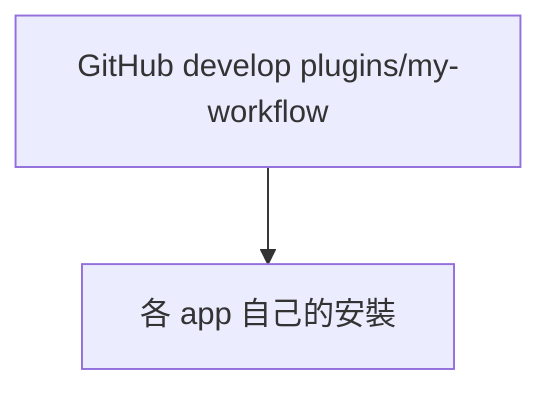

# my-workflow

私人工作流。不上架公開市集。plugin 版本 `0.2.1`。

之後開發維護以 [`AGENTS.md`](AGENTS.md) 為準。元件表見 [`skills/my-workflow/references/index.md`](skills/my-workflow/references/index.md)。

Plugin 本體在 `plugins/my-workflow`。追蹤分支 `develop`。

https://github.com/VECTOR-COOL/my-agent-toolkit/tree/develop/plugins/my-workflow

各 app 用自己的方式安裝這個網址。不要複製到家目錄，也不要做家目錄資料夾連結。



斜線命令一律 `my-workflow-` 開頭，例如 `/my-workflow-update`、`/my-workflow-docs`。入口 skill 仍是 `my-workflow`。

## 安裝 prompt

貼給 agent：

```text
安裝我的私人 plugin my-workflow。用你這個 app 自己的 plugin 安裝方式。

https://github.com/VECTOR-COOL/my-agent-toolkit/tree/develop/plugins/my-workflow

倉庫 https://github.com/VECTOR-COOL/my-agent-toolkit ，分支 develop，plugin 目錄 plugins/my-workflow。倉庫根 .agents/plugins/marketplace.json 只列 my-workflow。

不要自己複製檔案，不要做家目錄連結，不要改 plugin，不要 commit。
裝不起來就停，說明這個 app 卡在哪。
```

## 更新 prompt

貼給 agent：

```text
更新我的私人 plugin my-workflow。用你這個 app 自己的更新方式。

https://github.com/VECTOR-COOL/my-agent-toolkit/tree/develop/plugins/my-workflow

分支 develop。不要自己複製檔案，不要覆蓋別的安裝，不要改 Git 設定，不要 commit。
這個 app 沒有更新方式就停，說明一聲。
```

## 安裝

repo 要先推上 `develop`，而且帳號要能讀這個私有 repo。下面兩種裝法都還沒在這台機器跑過。

### Cursor

要用會自動更新的裝法。需要 Teams 或 Enterprise，以及這個 repo 上的 Cursor GitHub App。

1. Dashboard → Plugins & MCPs → Team Marketplaces → Add Marketplace → Import from Repo。
2. 貼 `https://github.com/VECTOR-COOL/my-agent-toolkit/tree/develop/plugins/my-workflow`。這是 plugin 目錄，不是整個 repo。
3. Marketplace Settings 打開 **Auto Refresh**，存檔。
4. Customize 安裝 `my-workflow`。

推上 `develop` 之後，Cursor 最多約 10 分鐘重新索引一次。重開視窗或視窗回到前景就會換成新版。不要用個人的 `/add-plugin` 貼 GitHub，那個會停在當初的 commit，不會跟著更新。

### Codex 與 ChatGPT 桌面

先跑 `codex plugin marketplace --help`。沒有這條子命令就先升級 Codex，不要改參數重試。

```text
codex plugin marketplace add https://github.com/VECTOR-COOL/my-agent-toolkit.git --ref develop
```

不要加 `--sparse`。這個網址是市集來源，不是把整個 repo 裝成 plugin。清單在倉庫根 [`.agents/plugins/marketplace.json`](../../.agents/plugins/marketplace.json)，只列 `my-workflow`。然後在 `/plugins` 或桌面的 Plugins 只安裝 `my-workflow`。

這個不會自動更新。要更新時執行：

```text
codex plugin marketplace upgrade
```

### Grok Bot

Grok Bot 有記憶規則，在 `skills/my-memory/references/grok-bot.md`。

沒有從 GitHub 安裝 plugin 的步驟。不要尋找 grok 命令列，也不要改走別的方法。

### 不能用這條 GitHub 連結的

| 環境 | 怎麼辦 |
|------|--------|
| Cursor Cloud／Cursor Grok Bot | 匯出到該專案的 `.cursor/skills` 與 `.cursor/rules`，再 commit |
| ChatGPT 網頁 | 上傳 skill 資料夾。先傳 `my-workflow`，再傳這次用得到的。改過就重新上傳 |
| grok.com | 不能裝 |

## 更新

| 環境 | 更新 |
|------|------|
| Cursor 團隊市集，已開 Auto Refresh | 自動。推上 `develop` 後重開視窗 |
| Codex／ChatGPT 桌面 | `codex plugin marketplace upgrade` |
| Grok Bot | 沒有這條安裝與更新。不要尋找 grok 命令列 |
| Cursor Cloud | 再跑下面的匯出並 commit |
| ChatGPT 網頁、grok.com | 不走這條 GitHub 更新 |

斜線命令 `/my-workflow-update` 只在 Codex 還沒升級、或 Cloud 要匯出時用。Cursor 已開 Auto Refresh 就不要再手動拉。

## Cursor Cloud 匯出

```text
node scripts/export-cursor-skills.mjs <目標專案> --dry-run
node scripts/export-cursor-skills.mjs <目標專案> --force
```

會寫入 `<目標專案>/.cursor/skills/` 與 `<目標專案>/.cursor/rules/`。那些檔由這個 plugin 產生，不要手改。改完後在該專案 commit。

本 toolkit 已匯出一份，給這個 repo 的 Cloud Agent 用。

## 元件

| 何時 | skill | Cursor 斜線 |
|------|-------|-------------|
| 新對話、不知用哪個 | `my-workflow` | `/my-workflow-start` |
| 更新本 plugin | `my-plugin-update` | `/my-workflow-update` |
| 記憶 | `my-memory` | `/my-workflow-memory` |
| 文件 | `my-docs` | `/my-workflow-docs` |

完整表見 [元件目錄](skills/my-workflow/references/index.md)。沒有斜線命令的 client 用 skill 名。

## 規格

- 維護準則：[`AGENTS.md`](AGENTS.md)
- Agent Plugins 1.0.0：`plugin.json` 與 `skills/`
- Cursor adapter：`.cursor-plugin/`、`rules/`、`commands/`
- Codex fallback：`.codex-plugin/`
- Grok／Claude layout：`.claude-plugin/`
- 沒有 `mcp.json`。記憶走 `my-memory`（Notion）
- plugin 版本 `0.2.1`，與 toolkit `project.json` 版本分開
